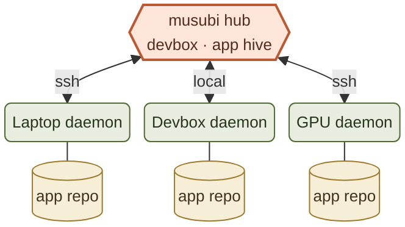

# How jj-musubi works

Pick up recorded work on another machine while keeping each checkout separate.

## Hubs, hives, and machines

A **hub** stores shared history and passes updates between machines. Each working machine
runs a **daemon** that sends and receives updates. Copies of one project form a **hive**;
a hub can serve several hives.



Each cylinder is a jj repo for the project `app`. The devbox hosts the hub and a working
copy. Other machines connect over ssh and reconnect after sleep or a network change.

Anyone who can reach a hub can read and write every hive it serves, so connect only machines
you trust with those repos. The [restricted ssh
key](reference/configuration.md#ssh) grants no other access to the hub's machine.
A lost hub can be [rebuilt from surviving copies](guides/manage.md#replace-or-move-a-hub).

## What moves between machines

A `jj` command that changes the repo records an operation in the
[operation log](https://docs.jj-vcs.dev/latest/operation-log/). The daemon sends new operations
and their commits to the hub, which passes them to the other machines, normally within a
second or so.

| Shared across the hive | Each machine's own |
| --- | --- |
| Commits, including snapshotted unfinished work and ones no bookmark points to | The checkout directory and its files on disk |
| Bookmarks, tags, and remote bookmarks | Files jj has not recorded, including ignored files |
| The operation log | Git remotes: their names and URLs |
| Each machine's working-copy commit, shown as a workspace | All jj configuration |
| | The commit index, which jj rebuilds |

[Configure remotes locally](guides/working-across-machines.md#configure-each-machine) on any
machine that will fetch or push. Its Git results then appear on all machines.

Snapshots replicate too, including files later removed. Sending can pause while receiving
continues; [snapshot limits and cleanup](guides/snapshots.md) explains the hold and recovery.

A copy starts sharing from its current repo state when it joins. Earlier operation
history stays local unless you choose `--full-history`; see
[Bring the operation history](guides/setup.md#bring-the-operation-history). The daemon
[cleans up unneeded older history](guides/manage.md#repo-cleanup).

Shared history lets `jj op log` show what every machine did, and `jj evolog` follow rewrites
made anywhere. You can [undo or restore shared
work](guides/working-across-machines.md#undo-across-machines) from another machine.
`jj op abandon` also affects every copy's operation log, leaving working-copy files and Git
refs unchanged. Read the
[abandonment rules](guides/working-across-machines.md#abandoning-operations) before using it
across machines.

## Working copies stay put

Background sync updates repo history and commits, and in a colocated repo, Git
refs that track bookmarks. It leaves checked-out files alone.

When another machine rewrites the commit you're using, jj treats your working copy as stale.
Your next `jj` command stops until you [update its
files](guides/working-across-machines.md#when-another-machine-rewrites-your-working-copy).

### Other machines' workspaces

Each machine has its own workspaces, including `default@`. Other machines' working-copy
commits appear under names such as `laptop/default@`:

```text
@  vruxwmqv me@example.com 2026-10-23 10:14:02 default@ 3f2a1c9e
│  (empty) (no description set)
│ ○  kkmpptxz me@example.com 2026-10-23 10:12:40 laptop/default@ 8d0b4e11
├─╯  Add retry logic to the fetcher
◆  zzzzzzzz root() 00000000
```

That name identifies the laptop's last snapshotted commit, not a checkout directory here.
You can [diff it or build on
it](guides/working-across-machines.md#see-what-other-machines-are-doing) like any revision.
Leaving or being forgotten removes these names; [manage copies and
machines](guides/manage.md#take-a-repo-or-machine-out) when they are no longer needed.

Moving a repo keeps its identity; copying its files makes a duplicate that cannot sync
as another copy. Use the [move, copy and restore
guide](guides/manage.md#move-copy-or-restore-a-repo) to move or replace one safely.

## When machines change the same thing

If your laptop and devbox rewrite the same change before they sync, jj keeps both versions
and marks the change as divergent. If they move the same bookmark to different commits before
syncing, the bookmark becomes conflicted.

[Resolve the conflict or
divergence](guides/working-across-machines.md#when-machines-change-the-same-thing)
on any machine; the resolution syncs to the others.

## Offline machines

You can keep using jj without the hub. On reconnection, the daemon fetches missed history,
merges local work and sends the result. `musubi status` reports failed syncs while offline;
[monitoring](guides/manage.md#check-syncing) explains those reports. Copies that miss an operation
abandonment may need [recovery](guides/working-across-machines.md#abandoning-operations).
