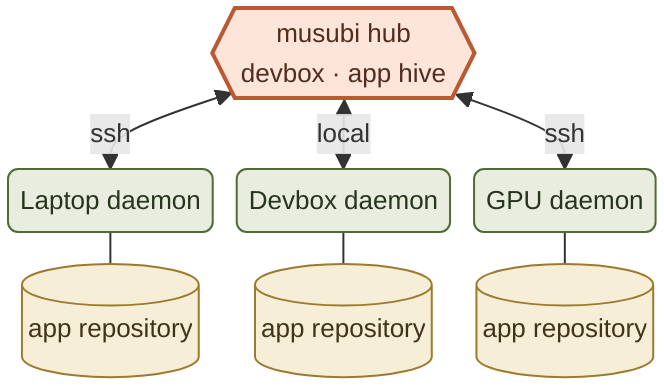

# How musubi works

What moves between machines, what stays on each, and what happens when machines make changes
concurrently.

musubi lets you pick up unfinished work on another machine, run agents on several machines,
and fetch or push once for all of them. Each machine has its own jj repository and checkout.
Shared history arrives in the repository; checked-out files stay as they are until you choose
to update them.

## The short version

One usually-on machine runs the **hub**, a musubi process that stores shared history and
passes updates between machines. A **daemon** is the background process on each working
machine that sends and receives those updates. All copies of one project form a **hive**;
a hub can serve several hives.

- Keep using jj. When a command records your edits, the daemon normally shares them within a
  second or so. Edits jj hasn't recorded yet stay on that machine.
- Each other machine's workspace appears in `jj log` as a name such as `laptop/default@`.
  The name identifies its recorded working-copy commit; it creates no checkout directory here.
- Work offline. jj needs no hub, and the daemon catches up when the connection returns.
- A [snapshot limit](#what-moves-between-machines) can hold sending while receiving continues.
  [Inspect and resolve a hold](guides/working-across-machines.md#when-snapshots-pick-up-too-much)
  when accidental files have entered old snapshots.

For picking up work, see [Work across machines](guides/working-across-machines.md). For what
sync can change and how to stop it, see [Trying musubi safely](safety.md). The
[design](internals/design.md) describes the mechanism.

## Hubs, hives, and machines



Each cylinder is a separate jj repository for the same project, `app`. The daemons share its
history through the hub; working-copy files stay on their own machines.

The hub's machine can also be a working machine, as the devbox is above. Other machines
reach the hub over ssh, and reconnect after a network change or sleep. The hub orders their
updates so concurrent changes combine once, using jj's merge behavior.

Anyone who can reach the hub can read and write every hive it serves. Use it for machines
you trust with all those repositories. The restricted ssh key musubi adds can reach the hub
and nothing else on its machine; [setup](guides/setup.md#the-ssh-key-musubi-adds) explains it.

## What moves between machines

Every `jj` command that changes the repository records what it did as an operation, in jj's
[operation log](https://docs.jj-vcs.dev/latest/operation-log/): the record that `jj undo` takes
back and `jj op log` shows. musubi syncs that record. Unless sending is held by the snapshot
limits below, the daemon sends each new operation, with the commits it needs, to the hub,
which passes it on to the other machines within a second or so. Every machine has the same
commits and the same history of how they got there.

| Shared across the hive | Each machine's own |
| --- | --- |
| Commits, including snapshotted unfinished work and ones no bookmark points to | The checkout directory and its files on disk |
| Bookmarks, tags, and remote bookmarks | Files jj has not recorded, including ignored files |
| The operation log | Git remotes: their names and URLs |
| Each machine's working-copy commit, shown as a workspace | All jj configuration |
| | The commit index, which jj rebuilds |

[Configure each machine](guides/working-across-machines.md#configure-each-machine) explains
local settings. Configure remotes explicitly on any machine that will fetch or push.

jj normally adds new, nonignored files when it next snapshots the working copy. Those recorded
contents replicate too. Ignoring a file already tracked requires `jj file untrack` as well;
[accidental-file recovery](troubleshooting.md#accidentally-added-files-and-sending-stopped)
shows how to keep files locally without sharing them.

Snapshots can retain accidental content even after a later snapshot removes it. To limit how
much spreads, musubi holds sending above 100 extra paths or 8 MiB beyond explicit change
history and content already shared with the hive. The limits add up across outgoing snapshots,
including files you've since removed. Receiving continues while you [inspect, approve or clean
up the held work](guides/working-across-machines.md#when-snapshots-pick-up-too-much).
Smaller accidental files can still reach every machine, even if you abandon them at once.
Keep secrets in ignored files.

By default, a copy starts sharing from its current repository state when it joins. Its earlier
operation history stays local unless you choose `--full-history`; see
[Bring the operation history](guides/setup.md#bring-the-operation-history).

Because the history since joining is shared, the rest of jj's behaviour carries across machines:

- `jj op log` shows what every machine did, and when.
- `jj evolog` follows a change through rewrites made anywhere.
- `jj op revert` and `jj op restore` work on operations from any machine. `jj undo` refuses
  to undo another machine's operation unless you pass `--allow-cross-workspace`, as it
  refuses another workspace's.
- A fetch or push on one machine updates the remote bookmarks on every machine, so you only
  need to fetch once.

## Working copies stay put

Background sync leaves working-copy files alone. It changes repository history and commits,
and in a colocated repository, Git refs that track bookmarks. Git remote definitions and jj
config stay local. A received working-copy commit is available to check out; your current
checkout stays where it was.

When another machine rewrites the commit your working copy is on, by rebasing its parent, say,
jj treats your working copy as stale, as it would after a rebase in another workspace on the
same machine, and your next `jj` command stops until you update the files. [When another
machine rewrites your working
copy](guides/working-across-machines.md#when-another-machine-rewrites-your-working-copy) says
what to do, and why musubi doesn't make jj do it by itself.

## Other machines' workspaces

Every machine has its own workspaces, its own `default@` among them, and also shows every
other machine's working copy as a workspace named after that machine:

```text
@  vruxwmqv me@example.com 2026-10-23 10:14:02 default@ 3f2a1c9e
│  (empty) (no description set)
│ ○  kkmpptxz me@example.com 2026-10-23 10:12:40 laptop/default@ 8d0b4e11
├─╯  Add retry logic to the fetcher
◆  zzzzzzzz root() 00000000
```

`laptop/default@` is the commit the laptop last snapshotted: edits it hasn't snapshotted yet
stay on the laptop, as they would in any workspace. You can diff it or build on it like any
revision; see [See what other machines are
doing](guides/working-across-machines.md#see-what-other-machines-are-doing).

A machine's name defaults to jj's `operation.hostname`; choose another with `--machine` when
you join. A machine that leaves with `musubi leave`, or that another machine forgets with
`musubi forget`, stops showing, and comes back if it's used again, unless other machines have
abandoned operations meanwhile (`jj op abandon`). See [Take a repository or machine
out](guides/manage.md#take-a-repository-or-machine-out).

## When machines change the same thing

Changes made on different machines combine exactly as jj combines changes made by concurrent
`jj` commands on one machine, and every machine ends up with the same result. A bookmark moved
to different commits on two machines is conflicted everywhere, and a change rewritten on two
machines is divergent everywhere, until you resolve it once, on any machine.
[Work across machines](guides/working-across-machines.md#when-machines-change-the-same-thing)
says how.

When two machines send updates at once, the hub accepts the first and turns the other away;
that machine merges its update with the first and sends the result. So each merge happens
once, on the machine that made the later change, and the hive never gets two copies of the
same rebase. [docs/internals/races.md](internals/races.md) lists every case musubi tests,
with its outcome.

## Offline machines

A machine that loses its connection to the hub keeps working: jj never needs the hub. When it
reconnects, its daemon fetches what it missed, merges its own work with it, and sends the
result, as for any concurrent change. Meanwhile, `musubi status` shows its syncs failing, which
is expected.

## Abandoning operations

`jj op abandon` removes those operations from every machine's operation log; working-copy
files and Git refs stay unchanged. musubi adds `musubi: pass on jj op abandon` operations to
preserve its records of active machines and their last activity.
A copy that goes offline during its first sync and stays away over a day, or less if the hub
restarts, can't sync again if another machine runs `jj op abandon` meanwhile
([abandonment rules and recovery](guides/working-across-machines.md#abandoning-operations)).

## Disk space

Every machine keeps every operation and commit of its hive, so the daemon cleans up what
`jj util gc` would: operations that nothing reachable from the current one needs, and files jj
no longer reads, none less than two weeks old. It runs once enough has built up, at most once
a week, skipping cleanup on battery power. It leaves git objects in place.

## Moving and copying repositories

A copy is the repository that joined, wherever you move it: the daemon follows it. A
repository made by copying a copy's files is a duplicate, which musubi doesn't sync, since
two repositories syncing as one would overwrite each other's working copy. See [Move, copy
or restore a repository](guides/manage.md#move-copy-or-restore-a-repository), and for the
cases musubi handles and leaves out, [docs/internals/copies.md](internals/copies.md).

## Operation ids differ between machines

Each machine records its own git refs and workspaces in its operations, so the same operation
has a different id on each machine and on the hub. Anything that names an operation, such as
`jj op restore <id>`, takes this machine's id. To find the same operation on another machine,
run `musubi debug op-id <id>` here, which prints the hive's id for it, then `musubi debug
op-id` with that id on the other machine.

## The hub needn't be durable

The machines keep the operations they send and receive. If the hub loses its state through a
power cut or a deleted directory, start a new one and make its hives again from surviving
machines' copies. Work that exists only on a lost machine still needs that machine's backup.
See [Replace or move a hub](guides/manage.md#replace-or-move-a-hub).
