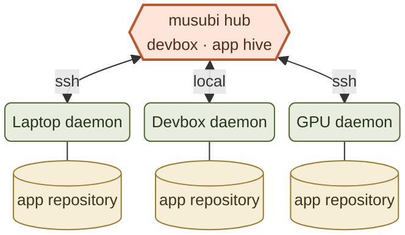

# How musubi works

What moves between machines, what stays on each, and what happens when machines make changes
concurrently.

musubi lets you pick up work on another machine, run agents on several machines, and fetch or push
once for all of them. Each machine has its own copy of the repository, and shows the others' work
as jj workspaces: separate checkouts that share a repository's history. For the design, see
[docs/internals/design.md](internals/design.md), and for how it's checked, [How musubi keeps your
work safe](safety.md).

## The short version

- The copies of one repository form a _hive_, managed by a _hub_. A hub can serve several hives.
  Each machine runs a daemon that keeps its copies in sync.
- Each machine's copy is an ordinary jj repository, with every commit, bookmark and change from
  every machine.
- You can unplug or suspend any machine and keep working.
- Each machine's working copy shows up as a workspace, such as `laptop/default@`. This
  identifies the commit its working copy is on. And if you have multiple workspaces on each
  machine, that's no problem.
- jj records your edits each time you run a `jj` command, and musubi sends each record to your
  other machines within a second or so. Edits you've made since your last `jj` command stay on
  that machine until the next one, or until [jj records them by
  itself](guides/working-across-machines.md#pick-up-on-another-machine).
- musubi never writes to your working copy. When another machine rewrites the commit you're on, jj
  says so (your working copy is stale), and you update your files when you choose.
- musubi never talks to GitHub or any other remote for you. When you push or fetch on one machine,
  though, every machine sees the result.
- The hub keeps a copy of each repository it serves. Your other machines reach it over ssh, with
  a special ssh key that can talk to the hub and nothing else on its machine. Each machine also
  keeps everything the hub holds. Anyone who can reach the hub can read and write every
  repository it serves, so treat it as you would any machine with your repositories on it.
- `musubi leave` takes a repository out of its hive, and it keeps everything it has, its working
  copy included.

## Hubs, hives, and machines



Each cylinder is a separate jj repository for the same project, `app`. The daemons share its
history through the hub; working-copy files stay on their own machines.

- A **hub** is a `musubi hub` process on a machine that is usually on. It keeps a full copy of
  each repository it serves and decides the order in which updates are accepted. It never makes
  changes of its own.
- A **hive** is one repository as the hub knows it: a name, such as `app`, and every
  machine's copy of it. One hub serves any number of hives.
- Each **machine** runs one **daemon**, which keeps every copy on that machine in sync with
  its hive. The hub's machine can have copies too, as `devbox` does above.

Other machines reach the hub over ssh, so wherever you can `ssh devbox`, musubi works. The
daemon reconnects by itself after a network change or a sleep.

## What moves between machines

Every `jj` command that changes the repository records what it did as an operation, in jj's
[operation log](https://docs.jj-vcs.dev/latest/operation-log/): the record that `jj undo` takes
back and `jj op log` shows. musubi syncs that record. The daemon sends each new operation,
with the commits it needs, to the hub, which passes it on to the other machines within a
second or so. Every machine has the same commits and the same history of how they got there.

| Shared across the hive | Each machine's own |
| --- | --- |
| Commits, including ones no bookmark points to | Working-copy files |
| Bookmarks, tags, and remote bookmarks | Untracked and ignored files |
| The operation log | Git remotes: their names and URLs |
| Each machine's working-copy commit, shown as a workspace | All jj configuration |
| | The commit index, which jj rebuilds |

[Configure each machine](guides/working-across-machines.md#configure-each-machine) explains
local settings. Configure remotes explicitly on any machine that will fetch or push.

Every snapshot of a working copy replicates too, so a file that jj snapshots reaches every
machine in the hive, even if you abandon it at once. Keep secrets in ignored files.

Because that history is shared, the rest of jj's behaviour carries across machines:

- `jj op log` shows what every machine did, and when.
- `jj evolog` follows a change through rewrites made anywhere.
- `jj op revert` and `jj op restore` work on operations from any machine. `jj undo` refuses
  to undo another machine's operation unless you pass `--allow-cross-workspace`, as it
  refuses another workspace's.
- A fetch or push on one machine updates the remote bookmarks on every machine, so you only
  need to fetch once.

## Working copies stay put

musubi never writes to working-copy files. It changes only what jj keeps (the operation log
and commits, and in a colocated repository, the `.git` refs that track bookmarks), and the
local Git refs. Git remote definitions and jj config stay local.

When another machine rewrites the commit your working copy is on, by rebasing its parent, say,
jj treats your working copy as stale, as it would after a rebase in another workspace on the
same machine, and your next `jj` command stops until you update the files. [When another
machine rewrites your working
copy](guides/working-across-machines.md#when-another-machine-rewrites-your-working-copy) says
what to do, and why musubi doesn't make jj do it by itself.

## Other machines' workspaces

Every machine has its own workspaces, its own `default@` among them, and also shows every
other machine's working copy as a workspace named after that machine:

```text
@  vruxwmqv me@example.com 2026-10-23 10:14:02 default@ 3f2a1c9e
│  (empty) (no description set)
│ ○  kkmpptxz me@example.com 2026-10-23 10:12:40 laptop/default@ 8d0b4e11
├─╯  Add retry logic to the fetcher
◆  zzzzzzzz root() 00000000
```

`laptop/default@` is the commit the laptop last snapshotted: edits it hasn't snapshotted yet
stay on the laptop, as they would in any workspace. You can diff it or build on it like any
revision; see [See what other machines are
doing](guides/working-across-machines.md#see-what-other-machines-are-doing).

A machine's name defaults to jj's `operation.hostname`; choose another with `--machine` when
you join. A machine that leaves with `musubi leave`, or that another machine forgets with
`musubi forget`, stops showing, and comes back if it's used again, unless other machines have
abandoned operations meanwhile (`jj op abandon`). See [Take a repository or machine
out](guides/manage.md#take-a-repository-or-machine-out).

## When machines change the same thing

Changes made on different machines combine exactly as jj combines changes made by concurrent
`jj` commands on one machine, and every machine ends up with the same result. A bookmark moved
to different commits on two machines is conflicted everywhere, and a change rewritten on two
machines is divergent everywhere, until you resolve it once, on any machine.
[Work across machines](guides/working-across-machines.md#when-machines-change-the-same-thing)
says how.

When two machines send updates at once, the hub accepts the first and turns the other away;
that machine merges its update with the first and sends the result. So each merge happens
once, on the machine that made the later change, and the hive never gets two copies of the
same rebase. [docs/internals/races.md](internals/races.md) lists every case musubi tests,
with its outcome.

## Offline machines

A machine that loses its connection to the hub keeps working: jj never needs the hub. When it
reconnects, its daemon fetches what it missed, merges its own work with it, and sends the
result, as for any concurrent change. Meanwhile, `musubi status` shows its syncs failing, which
is expected.

## Abandoning operations

`jj op abandon` on one machine removes those operations on every machine, and they never come
back; working copies and git refs are untouched. musubi adds an operation or two to the log,
`musubi: pass on jj op abandon`, so that what it keeps in the operation history, which
machines are active and when they last worked, stays as it was.
A copy that goes offline during its first sync and stays away over a day, or less if the hub
restarts, can't sync again if another machine runs `jj op abandon` meanwhile
([more](guides/working-across-machines.md#abandoning-operations)).

## Disk space

Every machine keeps every operation and commit of its hive, so the daemon cleans up what
`jj util gc` would: operations that nothing reachable from the current one needs, and files jj
no longer reads, none less than two weeks old. It runs once enough has built up, at most once
a week, skipping cleanup on battery power. It leaves git objects in place.

## Moving and copying repositories

A copy is the repository that joined, wherever you move it: the daemon follows it. A
repository made by copying a copy's files is a duplicate, which musubi doesn't sync, since
two repositories syncing as one would overwrite each other's working copy. See [Move, copy
or restore a repository](guides/manage.md#move-copy-or-restore-a-repository), and for the
cases musubi handles and leaves out, [docs/internals/copies.md](internals/copies.md).

## Operation ids differ between machines

Each machine records its own git refs and workspaces in its operations, so the same operation
has a different id on each machine and on the hub. Anything that names an operation, such as
`jj op restore <id>`, takes this machine's id. To find the same operation on another machine,
run `musubi debug op-id <id>` here, which prints the hive's id for it, then `musubi debug
op-id` with that id on the other machine.

## The hub needn't be durable

The machines keep the operations they send and receive. If the hub loses its state through a
power cut or a deleted directory, start a new one and make its hives again from the machines'
copies. See [Replace or move a hub](guides/manage.md#replace-or-move-a-hub).
