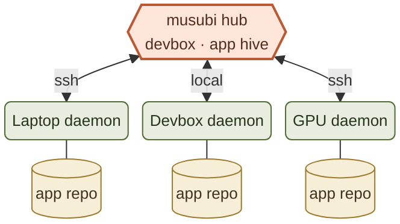

# How jj-musubi works

## Hubs, hives, and machines

A **hub** stores shared history and passes updates between machines. Each working machine
runs a **daemon** that sends and receives updates. Copies of one project form a **hive**;
a hub can serve several hives.



Each cylinder is a jj repo for the same project, `app`. The devbox hosts the hub and a working
copy. Other machines connect over ssh and reconnect after sleep or a network change.

jj-musubi is intended for single-person use. Anyone who can reach a hub can read and write every
hive it serves, so connect only machines and accounts you trust with those repos.

## What moves between machines

A `jj` command that changes the repo records an operation in its [operation
log](https://docs.jj-vcs.dev/latest/operation-log/), or op log. The daemon sends new operations
and their commits to the hub, which passes them to the other machines, usually within a second.

| Shared across the hive | Local to each repo |
| --- | --- |
| Commits, including snapshotted unfinished work | The checkout directory and its files on disk |
| Bookmarks, tags, and remote bookmarks | Files jj is not tracking |
| The operation log | Git remotes (names, URLs) |
| Each machine's working-copy commit, shown as a workspace | All jj configuration |

You'll need to [configure remotes
locally](guides/working-across-machines.md#configure-each-machine) on any machine that will
fetch or push. Its Git results will then appear on all machines.

Snapshots replicate too, with a fail-safe. If you accidentally add a bunch of files, by
unpacking a tarball in the wrong place, jj-musubi will put outgoing syncs on hold until you sort
things out, to avoid spamming all of your machines with junk snapshots. [Snapshot limits and
cleanup](guides/snapshots.md) explains these holds and how to handle them.

Shared history lets `jj op log` show what's happening on every machine, and `jj evolog` follows
rewrites made anywhere. You can [undo or restore shared
work](guides/working-across-machines.md#undo-across-machines) from another machine. `jj op
abandon` of operations other machines already have stops that copy syncing: read [Abandoning
operations](guides/working-across-machines.md#abandoning-operations) before using it. To remove
something from every machine, [clean up history on every
machine](guides/manage.md#clean-up-history-on-every-machine).

## Working copies stay put

The sync process updates repo history and commits, and Git refs that track bookmarks. When
another machine rewrites the commit you're using, jj treats your working copy as stale, just as
it would in a jj workspace.

When that happens, your next `jj` command will stop until you [update its
files](guides/working-across-machines.md#when-another-machine-rewrites-your-working-copy).

### Other machines' workspaces

Each repo on a machine can have multiple workspaces. These are prefixed with the name of the
machine, such as `laptop/`. Working-copy changes appear under names such as `laptop/default@`:

```text
@  vruxwmqv me@example.com 2026-10-23 10:14:02 default@ 3f2a1c9e
│  (empty) (no description set)
│ ○  kkmpptxz me@example.com 2026-10-23 10:12:40 laptop/default@ 8d0b4e11
├─╯  Add retry logic to the fetcher
◆  zzzzzzzz root() 00000000
```

That name identifies the laptop's last snapshotted commit. You can [diff it or build on
it](guides/working-across-machines.md#see-what-other-machines-are-doing) like any change. When
you leave or forget a machine, jj-musubi removes those names.

Because names with a `/` are how machines show each other's workspaces, a repo with a
workspace of yours named that way, such as `feat/x`, doesn't sync; other repos on the machine
sync on. `musubi sync` and `musubi status` say which workspace it is. Run `jj workspace rename
<new name>` in that workspace's directory, with no `/` in the new name, and the repo syncs
again, with the work you did meanwhile. If you ran `jj workspace forget` on it earlier, and
another machine's workspace now uses its name, [run `jj workspace remove <name>`
instead](troubleshooting.md#start-with-this-copy). If the directory is missing, as on a disk not
mounted, run `jj workspace forget <name>` from another workspace of the repo instead, or mount
the disk and rename it there.

Moving a repo will maintain its identity in jj-musubi's eyes, but copying its files makes a
*duplicate* with the same identity that cannot sync. Use the [move, copy and restore
guide](guides/manage.md#move-copy-or-restore-a-repo) to move or replace one safely.

## When machines change the same thing

jj has built-in machinery for dealing with conflicting modifications to a file, change, or
bookmark, and jj-musubi uses it in exactly the ways you'd expect.

If your laptop and devbox rewrite the same change before they sync, jj keeps both versions and
marks the change as divergent. If they move the same bookmark to different commits before
syncing, the bookmark becomes conflicted.

You can [resolve a conflict or
divergence](guides/working-across-machines.md#when-machines-change-the-same-thing) on any
machine; your resolution syncs to the others.

## Offline machines

You can keep using jj when you can't reach the hub. When you reconnect, the daemon fetches
missed history, merges local work, and syncs the result. `musubi status` reports failed syncs
while offline; [monitoring](guides/manage.md#check-syncing) explains those reports.
