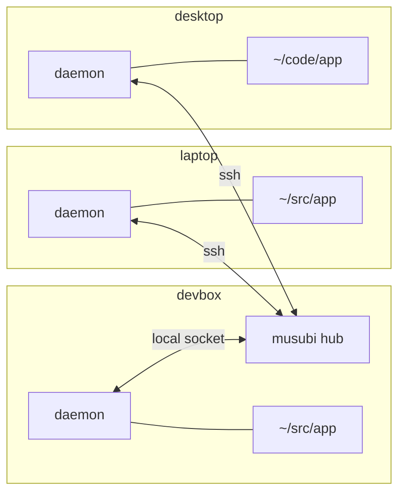

# How musubi works

musubi makes several machines' copies of one jj repository behave like workspaces of a single
repository. This page explains what that means in practice: what moves between machines, what
stays on each, and what you see when machines change the same thing at once. For the design
behind it, see [docs/internals/design.md](internals/design.md).

## Hubs, hives, and machines



- A **hub** is a `musubi hub` process on one machine that is usually on. It keeps a full copy
  of each repository it serves and decides the order in which updates land. It never makes
  changes of its own.
- A **hive** is one repository as the hub knows it: a name, such as `app`, and every
  machine's copy of it. One hub serves any number of hives.
- Each **machine** that takes part runs one **daemon**, which keeps every repository on that
  machine in its hive in sync. The hub's own machine can have copies too, as `devbox` does
  above.

Other machines reach the hub over ssh, so wherever you can `ssh devbox`, musubi works. The
daemon reconnects by itself after a network change or a sleep.

## What moves between machines

musubi replicates jj's [operation log](https://docs.jj-vcs.dev/latest/operation-log/), not
just branches. Every `jj` command that changes the repository records an operation, and the
daemon sends each new one, with the commits it needs, to the hub, which passes it on to the
other machines. They show up in `jj op log` there within a second or so.

| Shared across the hive | Each machine's own |
| --- | --- |
| Commits, including ones no bookmark points to | Working-copy files |
| Bookmarks, tags, and remote bookmarks | Untracked and ignored files |
| The operation log | User config (`~/.config/jj/config.toml`) |
| Each machine's working-copy commit, shown as a workspace | Most repo config |
| Git remotes: their names and URLs | The commit index, which jj rebuilds |
| Repo config that decides what is safe to rewrite or push | |

See [Share settings](guides/working-across-machines.md#share-settings) for which remotes and
repo config the hive shares, and how machines agree on them.

Every snapshot of a working copy replicates too, so a file that jj snapshots reaches every
machine in the hive, even if you abandon it at once. Keep secrets in ignored files.

Because the operation log replicates, the rest of jj's behaviour carries across machines:

- `jj op log` shows what every machine did, and when.
- `jj evolog` follows a change through rewrites made anywhere.
- `jj op revert` and `jj op restore` work on operations from any machine. `jj undo` refuses
  to undo another machine's operation unless you pass `--allow-cross-workspace`, as it
  refuses another workspace's.
- A fetch or push on one machine updates the remote bookmarks on every machine, so you only
  need to fetch once.

## Working copies stay put

musubi never writes to working-copy files. It changes only what `jj` itself keeps, the
operation log, commits, and, in a colocated repository, the `.git` refs that track bookmarks,
and the git remotes and repo config that the hive shares.

When another machine rewrites the commit your working copy is on, by rebasing its parent,
say, jj treats your working copy as stale, just as it would after a rebase in another
workspace on the same machine. Your next `jj` command stops and suggests
`jj workspace update-stale`, which updates the files. Any edits you hadn't snapshotted yet
are snapshotted first, so nothing is lost: at worst, the working-copy change becomes
divergent.

To have jj update stale working copies by itself, set `snapshot.auto-update-stale = true`.
musubi doesn't set it for you: with it on, any `jj` command, even `jj log`, can change files
under a running build or an open editor.

## Other machines' workspaces

Each machine keeps its own workspaces: every machine has its own `default@`. It also shows
every other machine's working copy, as a workspace named after that machine:

```text
@  vruxwmqv me@example.com 2026-10-23 10:14:02 default@ 3f2a1c9e
│  (empty) (no description set)
│ ○  kkmpptxz me@example.com 2026-10-23 10:12:40 laptop/default@ 8d0b4e11
├─╯  Add retry logic to the fetcher
◆  zzzzzzzz root() 00000000
```

You can build on another machine's working copy with `jj new laptop/default@`, or see what it
is doing with `jj diff -r laptop/default@`. Those are the commits the laptop last snapshotted:
edits it hasn't snapshotted yet stay on the laptop, as they would in any workspace.

A machine's name defaults to jj's `operation.hostname`. Choose another with `--machine` when
you join.

## When machines change the same thing

The rule is that changes made on different machines combine exactly as jj combines changes
made by concurrent `jj` commands on one machine, and every machine ends up with the same
result. A bookmark moved to different commits on two machines is conflicted everywhere, and a
change rewritten on two machines is divergent everywhere, until you resolve it once, on any
machine. See [When machines change the same
thing](guides/working-across-machines.md#when-machines-change-the-same-thing).

The hub orders updates: one machine's update lands, and the next is merged with it before it
lands too. That merge happens once, on the machine that made the later change, so the hive
never gets two copies of the same rebase. [docs/internals/races.md](internals/races.md)
lists every case musubi tests, with its outcome.

## Offline machines

A machine that loses its connection to the hub keeps working: jj never needs the hub. When it
reconnects, its daemon fetches what it missed, merges its own work with it, and sends the
result, as for any concurrent change. Meanwhile, `musubi list` shows its syncs failing, which
is expected.

## Operation ids differ between machines

Each machine records its own git refs and workspaces in its operations, so the same operation
has a different id on each machine and on the hub. Anything that names an operation, such as
`jj op restore <id>`, takes this machine's id. To find the same operation on another machine,
run `musubi debug op-id <id>` here, which prints its id in the hive, then `musubi debug op-id`
with that id on the other machine.

## The hub needn't be durable

Every machine has every operation it has seen, so a hub holds nothing that isn't on the
machines too. A hub that loses its state, through a power cut or a deleted directory, loses
no work: start a new one, and make its hives again from the machines' copies. See
[Replace or move a hub](guides/manage.md#replace-or-move-a-hub).
