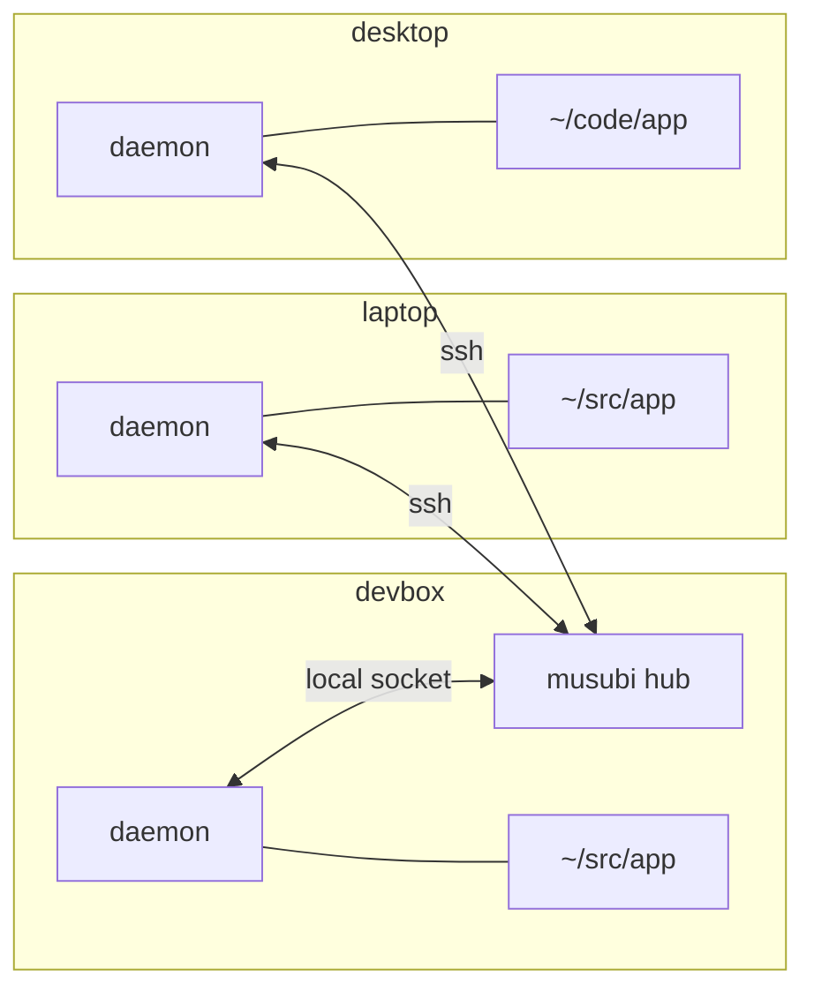

# How musubi works

musubi makes several machines' copies of one jj repository behave like workspaces of a single
repository. This page explains what moves between machines, what stays on each, and what you
see when machines change the same thing at once. For the design behind it, see
[docs/internals/design.md](internals/design.md).

## Hubs, hives, and machines



- A **hub** is a `musubi hub` process on a machine that is usually on. It keeps a full copy of
  each repository it serves and decides the order in which updates are accepted. It never makes
  changes of its own.
- A **hive** is one repository as the hub knows it: a name, such as `app`, and every
  machine's copy of it. One hub serves any number of hives.
- Each **machine** runs one **daemon**, which keeps every copy on that machine in sync with
  its hive. The hub's machine can have copies too, as `devbox` does above.

Other machines reach the hub over ssh, so wherever you can `ssh devbox`, musubi works. The
daemon reconnects by itself after a network change or a sleep.

## What moves between machines

musubi replicates jj's [operation log](https://docs.jj-vcs.dev/latest/operation-log/), not
just branches. Every `jj` command that changes the repository records an operation; the daemon
sends each new one, with the commits it needs, to the hub, which passes it on to the other
machines. It shows up in `jj op log` there within a second or so.

| Shared across the hive | Each machine's own |
| --- | --- |
| Commits, including ones no bookmark points to | Working-copy files |
| Bookmarks, tags, and remote bookmarks | Untracked and ignored files |
| The operation log | User config (`~/.config/jj/config.toml`) |
| Each machine's working-copy commit, shown as a workspace | Most repo config |
| Git remotes: their names and URLs | The commit index, which jj rebuilds |
| Repo config that decides what is safe to rewrite or push | |

[Share settings](guides/working-across-machines.md#share-settings) says which remotes and
repo config the hive shares, and how machines agree on them.

Every snapshot of a working copy replicates too, so a file that jj snapshots reaches every
machine in the hive, even if you abandon it at once. Keep secrets in ignored files.

Because the operation log replicates, the rest of jj's behaviour carries across machines:

- `jj op log` shows what every machine did, and when.
- `jj evolog` follows a change through rewrites made anywhere.
- `jj op revert` and `jj op restore` work on operations from any machine. `jj undo` refuses
  to undo another machine's operation unless you pass `--allow-cross-workspace`, as it
  refuses another workspace's.
- A fetch or push on one machine updates the remote bookmarks on every machine, so you only
  need to fetch once.

## Working copies stay put

musubi never writes to working-copy files. It changes only what jj keeps (the operation log
and commits, and in a colocated repository, the `.git` refs that track bookmarks), and the
git remotes and repo config that the hive shares.

When another machine rewrites the commit your working copy is on, by rebasing its parent, say,
jj treats your working copy as stale, as it would after a rebase in another workspace on the
same machine, and your next `jj` command stops until you update the files. [When another
machine rewrites your working
copy](guides/working-across-machines.md#when-another-machine-rewrites-your-working-copy) says
what to do, and why musubi doesn't make jj do it by itself.

## Other machines' workspaces

Every machine has its own workspaces, its own `default@` among them, and also shows every
other machine's working copy as a workspace named after that machine:

```text
@  vruxwmqv me@example.com 2026-10-23 10:14:02 default@ 3f2a1c9e
│  (empty) (no description set)
│ ○  kkmpptxz me@example.com 2026-10-23 10:12:40 laptop/default@ 8d0b4e11
├─╯  Add retry logic to the fetcher
◆  zzzzzzzz root() 00000000
```

`laptop/default@` is the commit the laptop last snapshotted: edits it hasn't snapshotted yet
stay on the laptop, as they would in any workspace. You can diff it or build on it like any
revision; see [See what other machines are
doing](guides/working-across-machines.md#see-what-other-machines-are-doing).

A machine's name defaults to jj's `operation.hostname`; choose another with `--machine` when
you join. A machine that leaves with `musubi leave`, or that another machine forgets with
`musubi forget`, stops showing, and comes back if it's used again. See [Take a repository or
machine out](guides/manage.md#take-a-repository-or-machine-out).

## When machines change the same thing

Changes made on different machines combine exactly as jj combines changes made by concurrent
`jj` commands on one machine, and every machine ends up with the same result. A bookmark moved
to different commits on two machines is conflicted everywhere, and a change rewritten on two
machines is divergent everywhere, until you resolve it once, on any machine.
[Work across machines](guides/working-across-machines.md#when-machines-change-the-same-thing)
says how.

When two machines send updates at once, the hub accepts the first and turns the other away;
that machine merges its update with the first and sends the result. So each merge happens
once, on the machine that made the later change, and the hive never gets two copies of the
same rebase. [docs/internals/races.md](internals/races.md) lists every case musubi tests,
with its outcome.

## Offline machines

A machine that loses its connection to the hub keeps working: jj never needs the hub. When it
reconnects, its daemon fetches what it missed, merges its own work with it, and sends the
result, as for any concurrent change. Meanwhile, `musubi status` shows its syncs failing, which
is expected.

## Disk space

Every machine keeps every operation and commit of its hive, so the daemon cleans up what
`jj util gc` would: operations that nothing reachable from the current one needs, and files jj
no longer reads, none less than two weeks old. It runs once enough has built up, at most once
a week, and not on battery. Unlike `jj util gc`, it deletes no git object.

## Operation ids differ between machines

Each machine records its own git refs and workspaces in its operations, so the same operation
has a different id on each machine and on the hub. Anything that names an operation, such as
`jj op restore <id>`, takes this machine's id. To find the same operation on another machine,
run `musubi debug op-id <id>` here, which prints the hive's id for it, then `musubi debug
op-id` with that id on the other machine.

## The hub needn't be durable

Every machine has every operation it has seen, so a hub holds nothing that isn't on the
machines too. A hub that loses its state, through a power cut or a deleted directory, loses no
work: start a new one, and make its hives again from the machines' copies. See [Replace or
move a hub](guides/manage.md#replace-or-move-a-hub).
